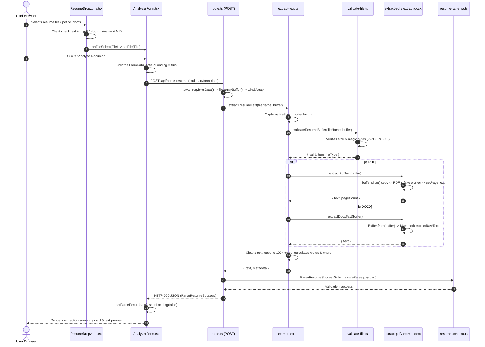

# Vett — System Architecture & Technical Specification

> **Status:** Phase 2 Complete (Document Parsing & Text Extraction Implemented). Phase 3 (LLM Analysis & Scoring) is **Planned**.  
> **Target Audience:** Engineering team and AI coding agents. This document is the practical, technical source of truth for the Vett codebase. For beginner study notes, conceptual tutorials, and interview revision, see [`docs/FILE_GUIDE.md`](./FILE_GUIDE.md).

---

## 1. Product Goals & Core Constraints

Vett is an explainable, privacy-first tool that compares a candidate's resume with a target job description and returns an **Estimated ATS Match Score**, matched evidence, identified gaps, and actionable recommendations.

### Architectural Invariants
1. **Heuristic Estimate, Not Proprietary ATS Emulation**: Vett evaluates textual alignment against the supplied job description. It does not predict or guarantee scores from proprietary third-party ATS platforms (e.g., Workday, Taleo).
2. **Privacy by Default (Zero Permanent Storage)**: Resumes and job descriptions are processed exclusively in volatile memory buffers and discarded when the request completes. No uploads folder, cloud object store (S3), or database persistence exists in the MVP.
3. **Resumes & Job Descriptions are Untrusted Data**: Uploaded documents are treated as untrusted data payloads, never as system instructions. Defenses prevent buffer overflows, zip bombs, and prompt injections.
4. **Deterministic Scoring in Application Code**: Categorical match scores are computed by deterministic mathematical formulas in application code, never delegated as unchecked numbers to an LLM.
5. **Explicit Runtime Contracts**: All network inputs, internal parser outputs, and API responses are strictly validated at runtime with Zod schemas.

---

## 2. Technology Stack

| Layer | Technology | Version | Purpose & Rationale |
|---|---|---|---|
| **Framework** | Next.js (App Router) | 16.4.0 | Unified React full-stack framework; hosts server-rendered UI and server-only API Route Handlers on one origin with zero CORS overhead. |
| **UI Library** | React | 19.3.0 | Component rendering, event handling, and interactive client state management. |
| **Language** | TypeScript | 5.x | Strict-mode static typing across client and server boundaries. |
| **Styling** | Tailwind CSS | 4.x | Utility styling mapped to semantic CSS custom properties in `@theme` for instant light/dark mode switching. |
| **Validation** | Zod | 4.6.7 | Runtime schema validation for request payloads, parser outputs, and API responses. Single source of truth for inferred TypeScript types. |
| **PDF Extraction** | PDF.js (`pdfjs-dist`) | 6.4.299 | Mozilla's open-source engine; runs in server-safe fake-worker mode to parse text-based PDFs without external SaaS dependencies. |
| **DOCX Extraction**| Mammoth | 1.13.0 | Fast, lightweight extraction of raw paragraph text from OpenXML Word archives. |
| **AI Integration** | Vercel AI SDK (`ai`) | *Planned (Phase 3)* | Standardized interface for structured LLM completion and streaming. |

---

## 3. High-Level System Architecture

```mermaid
flowchart TD
    subgraph Client ["Client Browser (React 19)"]
        Dropzone["ResumeDropzone.tsx<br/>(File selection & client pre-validation)"]
        JDInput["JobDescriptionInput.tsx<br/>(Controlled job description textarea)"]
        Form["AnalyzerForm.tsx<br/>(State orchestration & fetch submission)"]
        Dropzone -->|File| Form
        JDInput -->|Text| Form
    end

    subgraph Server ["Next.js Server Runtime (Node.js)"]
        Route["route.ts (POST /api/parse-resume)<br/>(Multipart ingestion & ArrayBuffer allocation)"]
        Core["extract-text.ts<br/>(Size capture, orchestration, text bounding)"]
        Val["validate-file.ts<br/>(Magic bytes & size ceiling validation)"]
        PDF["extract-pdf.ts<br/>(PDF.js fake worker, isolated memory copy)"]
        DOCX["extract-docx.ts<br/>(Mammoth raw text extraction)"]
        Zod["resume-schema.ts<br/>(Runtime Zod response validation)"]

        Form -->|"POST multipart/form-data"| Route
        Route --> Core
        Core --> Val
        Val -->|If PDF (%PDF)| PDF
        Val -->|If DOCX (PK..)| DOCX
        PDF --> Core
        DOCX --> Core
        Core --> Route
        Route --> Zod
    end

    subgraph FutureAI ["Planned Phase 3: AI Analysis Layer"]
        AnalyzeRoute["POST /api/analyze"]
        PromptBuilder["Prompt Builder (XML Delimiters)"]
        LLM["Configured LLM Provider"]
        ScoreEngine["Scoring Engine (Weighted Math)"]

        AnalyzeRoute -.-> Core
        AnalyzeRoute -.-> PromptBuilder
        PromptBuilder -.-> LLM
        LLM -.-> ScoreEngine
    end

    Zod -->|"HTTP 200 JSON (ParseResumeSuccess)"| Form
    Route -.->|"HTTP 400/500 JSON (ParseResumeError)"| Form
```

---

## 4. Current Implementation vs. Planned Roadmap

To maintain clarity during development, features are categorized by implementation status:

| Component / Feature | Status | Location in Codebase |
|---|---|---|
| **Responsive Minimal UI** | **Implemented** | `src/components/`, `src/app/page.tsx` |
| **Light / Dark / System Theme** | **Implemented** | `ThemeToggle.tsx`, `layout.tsx`, `globals.css` |
| **Client-Side File Pre-validation** | **Implemented** | `ResumeDropzone.tsx` ($\le 4\text{ MiB}$, `.pdf`, `.docx`) |
| **Server Binary Magic-Byte Check** | **Implemented** | `src/lib/resume/validate-file.ts` (`%PDF`, `PK\x03\x04`) |
| **In-Memory PDF Text Extraction** | **Implemented** | `src/lib/resume/extract-pdf.ts` (PDF.js fake worker) |
| **In-Memory DOCX Text Extraction** | **Implemented** | `src/lib/resume/extract-docx.ts` (Mammoth) |
| **Text Normalization & Bounding** | **Implemented** | `src/lib/resume/extract-text.ts` (capped at 100,000 chars) |
| **Resume Extraction API Endpoint** | **Implemented** | `src/app/api/parse-resume/route.ts` |
| **Runtime Zod Response Validation**| **Implemented** | `src/lib/validation/resume-schema.ts` |
| **Extracted Text Preview UI** | **Implemented** | `AnalyzerForm.tsx` (Phase 2 preview state) |
| **Job Description API Ingestion** | **Planned (Phase 3)** | Target endpoint: `POST /api/analyze` |
| **LLM Structured Output Pipeline** | **Planned (Phase 3)** | Vercel AI SDK integration via server environment variables |
| **Deterministic Scoring Formula** | **Planned (Phase 3)** | Pure TypeScript weighted formula: $35/25/25/15$ |
| **Full Results Report Screen** | **Planned (Phase 4)** | Scorecard, category breakdowns, evidence, gaps, suggestions |
| **Automated Testing Suite** | **Planned (Phase 5)** | Vitest, React Testing Library, Playwright (deferred per `AGENTS.md`) |
| **User Accounts & DB History** | **Deferred** | Out of scope for MVP; evaluate post-release |
| **Scanned Resume OCR** | **Deferred** | Out of scope for MVP; image-only PDFs return `SCANNED_PDF` |

---

## 5. Repository Structure & File Responsibilities

```text
src/
├── app/
│   ├── api/parse-resume/
│   │   └── route.ts            # Server route handler for POST /api/parse-resume
│   ├── globals.css             # Tailwind v4 setup & CSS design tokens
│   ├── layout.tsx              # Root HTML shell with FOUC prevention theme script
│   └── page.tsx                # Main screen page shell (Server Component)
├── components/
│   ├── AnalyzerForm.tsx        # Central interactive workflow controller (Client Component)
│   ├── Header.tsx              # Header with wordmark and theme controls
│   ├── JobDescriptionInput.tsx # Controlled textarea with character counter
│   ├── ResumeDropzone.tsx      # Accessible drag-and-drop file target
│   └── ThemeToggle.tsx         # Appearance switch using useSyncExternalStore
├── lib/
│   ├── constants.ts            # Centralized limits, extensions, and MIME constants
│   ├── formatters.ts           # Pure helpers for human-readable byte sizes
│   ├── resume/
│   │   ├── extract-docx.ts     # DOCX raw text extraction via Mammoth
│   │   ├── extract-pdf.ts      # PDF text and page extraction via PDF.js
│   │   ├── extract-text.ts     # Parsing pipeline coordinator & text normalizer
│   │   └── validate-file.ts    # Binary magic-byte & size validation
│   └── validation/
│       └── resume-schema.ts    # Zod contracts & inferred TypeScript types
└── types/
    └── modules.d.ts            # Ambient declarations for mammoth & pdf.worker.mjs
```

### Module Responsibilities & Contracts

#### `src/app/api/parse-resume/route.ts`
- **Role:** HTTP gateway.
- **Input:** `NextRequest` with `multipart/form-data`.
- **Output:** `NextResponse.json` containing `ParseResumeSuccess` (HTTP 200) or `ParseResumeError` (HTTP 400/500).
- **Behavior:** Unpacks `resume` File, converts to `Uint8Array`, delegates to `extractResumeText()`, validates response with `ParseResumeSuccessSchema.safeParse()`, and maps domain errors to typed status codes.

#### `src/lib/resume/extract-text.ts`
- **Role:** Domain extraction orchestrator.
- **Input:** `fileName: string`, `buffer: Uint8Array`.
- **Output:** `Promise<ExtractResumeResult>` (`{ text, metadata }`).
- **Behavior:** Captures `fileSize = buffer.length` upfront, executes binary validation, routes to PDF or DOCX parsers, strips carriage returns, clamps text to 100,000 characters (`MAX_EXTRACTED_RESUME_CHARS`), and calculates character/word counts.

#### `src/lib/resume/validate-file.ts`
- **Role:** Binary signature and size validator.
- **Input:** `fileName: string`, `buffer: Uint8Array`.
- **Output:** `FileValidationResult` (`{ valid, fileType, error, code }`).
- **Behavior:** Enforces $\le 4\text{ MiB}$ limit and checks magic bytes:
  - PDF: `0x25 0x50 0x44 0x46` (`%PDF`)
  - DOCX: `0x50 0x4B 0x03 0x04` (`PK\x03\x04`)

#### `src/lib/resume/extract-pdf.ts`
- **Role:** PDF.js integration.
- **Input:** `buffer: Uint8Array`.
- **Output:** `Promise<PdfExtractionResult>` (`{ text, pageCount }`).
- **Behavior:** Eagerly imports `pdf.worker.mjs` to establish `globalThis.pdfjsWorker.WorkerMessageHandler` in memory. Clones buffer via `buffer.slice()` to prevent thread detachment. Decodes page text streams sequentially. Detects scanned/image-only PDFs ($<10$ alphanumeric characters) and throws `SCANNED_PDF`.

#### `src/lib/resume/extract-docx.ts`
- **Role:** Mammoth DOCX integration.
- **Input:** `buffer: Uint8Array`.
- **Output:** `Promise<DocxExtractionResult>` (`{ text }`).
- **Behavior:** Wraps byte buffer into Node.js `Buffer` and extracts raw paragraphs. Rejects documents with $<5$ alphanumeric characters.

#### `src/lib/validation/resume-schema.ts`
- **Role:** API contract and schema validation.
- **Exports:** `ResumeMetadataSchema`, `ParseResumeSuccessSchema`, `ParseResumeErrorSchema`.
- **Inferred Types:** `ResumeMetadata`, `ParseResumeSuccess`, `ParseResumeError`, `ParseResumeResponse`.

---

## 6. End-to-End Request & Response Flow



---

## 7. Key Technical Decisions & Debugging Lessons

### 1. The PDF.js Worker Resolution in Node.js
- **Problem:** In Node.js, Web Workers do not exist. When `pdfjs.getDocument()` ran inside Next.js server bundles, PDF.js attempted a dynamic import of `./pdf.worker.mjs` using `/*webpackIgnore: true*/`. This failed with `Cannot find module './pdf.worker.mjs'`.
- **Solution:** In `extract-pdf.ts`, we eagerly import `pdfjs-dist/legacy/build/pdf.worker.mjs` before initializing the main engine. This sets `globalThis.pdfjsWorker = { WorkerMessageHandler }` directly in memory, causing PDF.js to use the in-memory fake worker and bypass dynamic file loading. Additionally, `serverExternalPackages: ["pdfjs-dist"]` is configured in `next.config.ts`.

### 2. The `ArrayBuffer` Detachment Bug
- **Problem:** After fixing the worker, PDF parsing returned `HTTP 500` with Zod error: `metadata.fileSize: File size must be positive`. The size was evaluating to `0` for valid 107 KB files.
- **Root Cause:** PDF.js transfers its input `ArrayBuffer` to its worker message port via structured cloning. In JavaScript, transferring an `ArrayBuffer` **detaches (neuters)** the source buffer, dropping its `byteLength` and any view's `.length` to `0`. Reading `buffer.length` after parsing produced `0`.
- **Solution:** 
  1. `extract-text.ts` records `const fileSize = buffer.length` at the start of execution before passing it to any parser.
  2. `extract-pdf.ts` clones the buffer (`new Uint8Array(buffer.slice())`) so only an isolated memory copy is transferred and detached.

### 3. Dual-Layer Validation (UX vs. Security)
- **Decision:** Client validation in `ResumeDropzone.tsx` catches invalid formats immediately to save bandwidth. Server validation in `validate-file.ts` never trusts client claims and verifies the underlying binary magic bytes.

---

## 8. Planned Phase 3 Architecture: AI Analysis & Scoring

When Phase 3 is implemented, the backend will introduce `POST /api/analyze` to compare resume text with the job description.

### Input Data Boundary & Prompt Injection Defense
Resumes and job descriptions are **untrusted user input**. They must never be interpolated directly into raw prompt strings.
1. **Delimited Context Framing**: Documents will be isolated inside strict XML boundary tags (`<resume_text>` and `<job_description>`).
2. **System Instruction Precedence**: System prompts mandate that text within these tags represents raw data to analyze, never instructions to execute.
3. **Structured Schema Output**: Output is constrained to a typed JSON schema via the Vercel AI SDK (`generateObject`), preventing freeform text jailbreaks.

### Deterministic Scoring Engine
The LLM does **not** generate the final aggregate score. It outputs categorical sub-scores (0–100), and application code calculates the weighted average:

$$\text{Estimated ATS Match Score} = \text{round}(S_{\text{skills}} \times 0.35 + S_{\text{responsibilities}} \times 0.25 + S_{\text{experience}} \times 0.25 + S_{\text{keywords}} \times 0.15)$$

| Category | Weight | Focus |
|---|---:|---|
| **Required Skills Match** | 35% | Direct presence of mandatory technical skills, tools, and methodologies. |
| **Responsibilities & Experience** | 25% | Alignment with required duties, role scope, and seniority expectations. |
| **Relevant Projects & Impact** | 25% | Concrete accomplishments, domain relevance, and demonstrable outcomes. |
| **Keyword & Industry Coverage** | 15% | Standard industry terminology and domain-specific concepts. |
| **Total** | **100%** | Rounded integer in the range $[0, 100]$. |

---

## 9. Security, Privacy & Operational Guardrails

- **Zero Permanent Storage**: No resumes, job descriptions, or AI results are saved to disk or databases.
- **Safe Error Telemetry**: Server errors logged for diagnostics contain only field paths, error codes, and exception types. Resume text, personal candidate details, and provider secrets are strictly excluded from logs.
- **Request Body & Memory Ceilings**: Uploads are restricted to 4 MiB (4,194,304 bytes), well within Vercel's 4.5 MB serverless body limit. Extracted text is clamped to 100,000 characters.
- **Secrets Management**: LLM provider API keys reside strictly in server-only environment variables (`.env.local`). Secrets are never prefixed with `NEXT_PUBLIC_` or bundled into client code.
