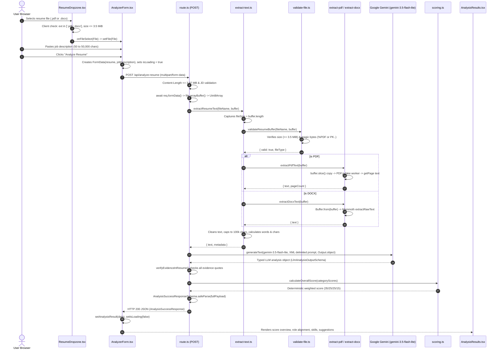

# Vett — System Architecture & Technical Specification

> **Status:** Current MVP Architecture (Implemented MVP; requires abuse protection and privacy review before public launch).<br/>
> **Target Audience:** Engineering team and AI coding agents. This document is the practical, technical source of truth for the Vett codebase. For beginner study notes, conceptual tutorials, and interview revision, see [`docs/FILE_GUIDE.md`](./FILE_GUIDE.md).

---

## 1. Product Goals & Core Constraints

Vett is an explainable, privacy-first web application that compares a candidate's resume with a target job description and returns an **Estimated ATS Match Score**, verified evidence, identified gaps, keyword coverage, and actionable recommendations.

### Architectural Invariants
1. **Heuristic Estimate, Not Proprietary ATS Emulation**: Vett evaluates textual alignment against the supplied job description. It does not predict or guarantee scores from proprietary third-party ATS platforms (e.g., Workday, Taleo, Greenhouse).
2. **Privacy by Default (Zero Permanent Storage)**: Resumes and job descriptions are processed exclusively in volatile memory buffers and discarded when the request completes. No uploads folder, cloud object store (S3), or database persistence exists in Vett's infrastructure.
3. **Resumes & Job Descriptions are Untrusted Data**: Uploaded documents are treated as untrusted data payloads, never as system instructions. Defenses bound file size, sanitize text, and isolate input inside strict XML tags.
4. **Deterministic Scoring in Application Code**: Categorical match scores are computed by deterministic mathematical formulas in application code (35% skills, 25% responsibilities, 25% projects, 15% keywords), never delegated as unchecked numbers to an LLM.
5. **Explicit Runtime Contracts**: All network inputs, internal parser outputs, and API responses are strictly validated at runtime with Zod schemas.

---

## 2. Technology Stack

| Layer | Technology | Version | Purpose & Rationale |
|---|---|---|---|
| **Framework** | Next.js (App Router) | 16.4.2 | Full-stack React framework; hosts server-rendered UI and server-only API Route Handlers on one origin with zero CORS overhead. |
| **UI Library** | React | 19.3.0 | Component rendering, event handling, and interactive client state management. |
| **Language** | TypeScript | 5.x | Strict-mode static typing across client and server boundaries. |
| **Styling** | Tailwind CSS | 4.x | Utility styling mapped to semantic CSS custom properties in `@theme` for instant light/dark mode switching. |
| **Validation** | Zod | 4.6.7 | Runtime schema validation for request payloads, LLM output, and API responses. Single source of truth for inferred TypeScript types. |
| **PDF Extraction** | PDF.js (`pdfjs-dist`) | 6.4.299 | Mozilla's open-source engine; runs in server-safe fake-worker mode to parse text-based PDFs without external SaaS dependencies. |
| **DOCX Extraction**| Mammoth | 1.13.0 | Fast, lightweight extraction of raw paragraph text from OpenXML Word archives. |
| **AI Integration** | Vercel AI SDK (`ai`, `@ai-sdk/google`) | 7.0.142 / 4.0.97 | Type-safe structured output generation (`Output.object`) using Google Gemini (`gemini-3.5-flash-lite`). |
| **Icons** | Lucide React | 1.58.0 | Lightweight, tree-shaken UI icons for headers, buttons, and status badges. |
| **Testing** | Node.js Test Runner | Native | Zero-dependency unit test suite (`npm test`) covering scoring, validation, and quotation verification. |

---

## 3. High-Level System Architecture

```mermaid
flowchart TD
    subgraph Client ["Client Browser (React 19)"]
        Dropzone["ResumeDropzone.tsx<br/>(File selection & client pre-validation)"]
        JDInput["JobDescriptionInput.tsx<br/>(Controlled job description textarea)"]
        Form["AnalyzerForm.tsx<br/>(State orchestration & fetch submission)"]
        Results["AnalysisResults.tsx<br/>(Coordinating parent component)"]
        ChildViews["Child Section Components<br/>(ScoreOverview, RoleAlignment, SkillsEvidence,<br/>Recommendations, ResumeReadability)"]

        Dropzone -->|File| Form
        JDInput -->|Text| Form
        Form -->|On Success| Results
        Results --> ChildViews
    end

    subgraph Server ["Next.js Server Runtime (Node.js)"]
        Route["route.ts (POST /api/analyze-resume)<br/>(Ingress guard, pipeline coordinator)"]
        Core["extract-text.ts<br/>(Size capture, coordinator, text bounding)"]
        Val["validate-file.ts<br/>(Magic bytes & size ceiling validation)"]
        PDF["extract-pdf.ts<br/>(PDF.js fake worker, isolated memory copy)"]
        DOCX["extract-docx.ts<br/>(Mammoth raw text extraction)"]
        Prompts["prompts.ts<br/>(XML-delimited prompt builder)"]
        Scorer["scoring.ts<br/>(Deterministic 35/25/25/15 weighting)"]
        Zod["analysis-schema.ts<br/>(Runtime Zod contracts)"]

        Form -->|"POST multipart/form-data"| Route
        Route --> Core
        Core --> Val
        Val -->|If PDF (%PDF)| PDF
        Val -->|If DOCX (PK..)| DOCX
        PDF --> Core
        DOCX --> Core
        Core --> Route
        Route --> Prompts
        Route --> Scorer
        Route --> Zod
    end

    subgraph ExternalAI ["Google Cloud / Google AI Studio"]
        Gemini["Google Gemini API<br/>(gemini-3.5-flash-lite)"]
        Prompts -->|Prompt + Instructions| Gemini
        Gemini -->|Structured JSON Object| Route
    end

    Zod -->|"HTTP 200 JSON (AnalysisSuccessResponse)"| Form
    Route -.->|"HTTP 400/429/500/502/504 JSON (AnalysisErrorResponse)"| Form
```

---

## 4. Current Implementation Status

| Component / Feature | Status | Location in Codebase |
|---|---|---|
| **Responsive Minimal UI** | **Implemented** | `src/components/`, `src/app/page.tsx` |
| **Light / Dark / System Theme** | **Implemented** | `ThemeToggle.tsx`, `layout.tsx`, `globals.css` |
| **Client-Side File Pre-validation** | **Implemented** | `ResumeDropzone.tsx` ($\le 3.5\text{ MiB}$, `.pdf`, `.docx`) |
| **Server Binary Magic-Byte Check** | **Implemented** | `src/lib/resume/validate-file.ts` (`%PDF`, `PK\x03\x04`) |
| **In-Memory PDF Text Extraction** | **Implemented** | `src/lib/resume/extract-pdf.ts` (PDF.js fake worker) |
| **In-Memory DOCX Text Extraction** | **Implemented** | `src/lib/resume/extract-docx.ts` (Mammoth) |
| **Text Normalization & Bounding** | **Implemented** | `src/lib/resume/extract-text.ts` (capped at 100,000 chars) |
| **Analysis Route Handler** | **Implemented** | `src/app/api/analyze-resume/route.ts` |
| **Runtime Zod Response Validation**| **Implemented** | `src/lib/validation/analysis-schema.ts` |
| **LLM Structured Output Pipeline** | **Implemented** | Vercel AI SDK `generateText` with `gemini-3.5-flash-lite` |
| **Evidence Quotation Verification** | **Implemented** | `verifyEvidenceInResume()` in `route.ts` |
| **Deterministic Scoring Formula** | **Implemented** | Pure TypeScript weighted formula: $35/25/25/15$ |
| **Refactored Results Interface** | **Implemented** | `AnalysisResults.tsx` + 5 child section components |
| **Automated Testing Suite** | **Implemented** | Native Node.js test runner (`npm test`) |
| **Custom App-Level Rate Limiter** | **Removed** | Defer abuse control to edge/hosting layer (e.g. Vercel Firewall) |
| **User Accounts & DB History** | **Out of Scope** | Deliberately excluded for zero-storage MVP |
| **Scanned Resume OCR** | **Out of Scope** | Image-only PDFs rejected with `SCANNED_PDF` code |

---

## 5. Repository Structure & File Responsibilities

```text
src/
├── app/
│   ├── api/analyze-resume/
│   │   └── route.ts            # Server route handler for POST /api/analyze-resume
│   ├── globals.css             # Tailwind v4 setup & CSS design tokens
│   ├── layout.tsx              # Root HTML shell with FOUC prevention theme script
│   └── page.tsx                # Main screen page shell (Server Component)
├── components/
│   ├── AnalyzerForm.tsx        # Central interactive workflow controller (Client Component)
│   ├── AnalysisResults.tsx     # Coordinating parent for results visualization
│   ├── analysis-results/
│   │   ├── ScoreOverview.tsx           # Match score, score band, category cards & metadata
│   │   ├── RoleAlignmentSection.tsx    # Responsibilities and project depth assessment
│   │   ├── SkillsEvidenceSection.tsx   # Verified skills, missing requirements, keyword coverage
│   │   ├── RecommendationsSection.tsx  # Prioritized improvement suggestions
│   │   └── ResumeReadabilitySection.tsx# Document structure notes, disclaimer & reset action
│   ├── Header.tsx              # Header with wordmark and theme controls
│   ├── JobDescriptionInput.tsx # Controlled textarea with character counter
│   ├── ResumeDropzone.tsx      # Accessible drag-and-drop file target
│   └── ThemeToggle.tsx         # Appearance switch using useSyncExternalStore & Lucide icons
├── lib/
│   ├── constants.ts            # Centralized limits, extensions, and MIME constants
│   ├── formatters.ts           # Pure helpers for human-readable byte sizes
│   ├── resume/
│   │   ├── extract-docx.ts     # DOCX raw text extraction via Mammoth
│   │   ├── extract-pdf.ts      # PDF text and page extraction via PDF.js
│   │   ├── extract-text.ts     # Parsing pipeline coordinator & text normalizer
│   │   └── validate-file.ts    # Binary magic-byte & size validation
│   ├── analysis/
│   │   ├── prompts.ts          # XML-delimited prompts & injection defense
│   │   └── scoring.ts          # Deterministic 35/25/25/15 scoring calculator
│   └── validation/
│       ├── resume-schema.ts    # Resume metadata schema
│       └── analysis-schema.ts  # End-to-end request, LLM output & response contracts
└── types/
    └── modules.d.ts            # Ambient declarations for mammoth & pdf.worker.mjs

tests/
└── scoring-and-validation.test.mjs # Unit tests for scoring, verification, and schema bounds
```

---

## 6. End-to-End Request & Response Flow



---

## 7. Key Technical Decisions & Debugging Lessons

### 1. The PDF.js Worker Resolution in Node.js
- **Problem:** In Node.js serverless environments, browser Web Workers do not exist. When `pdfjs.getDocument()` ran inside Next.js server bundles, PDF.js attempted a dynamic import of `./pdf.worker.mjs` using `/*webpackIgnore: true*/`. This failed with `Cannot find module './pdf.worker.mjs'`.
- **Solution:** In `extract-pdf.ts`, we eagerly import `pdfjs-dist/legacy/build/pdf.worker.mjs` before initializing the main engine. This sets `globalThis.pdfjsWorker = { WorkerMessageHandler }` directly in memory, causing PDF.js to use the in-memory fake worker and bypass dynamic file loading. Additionally, `serverExternalPackages: ["pdfjs-dist"]` is configured in `next.config.ts`.

### 2. The `ArrayBuffer` Detachment Bug
- **Problem:** After fixing the worker, PDF parsing returned `HTTP 500` with Zod error: `metadata.fileSize: File size must be positive`. The size was evaluating to `0` for valid 100 KB files.
- **Root Cause:** PDF.js transfers its input `ArrayBuffer` to its worker message port via structured cloning. In JavaScript, transferring an `ArrayBuffer` **detaches (neuters)** the source buffer, dropping its `byteLength` and any view's `.length` to `0`. Reading `buffer.length` after parsing produced `0`.
- **Solution:** 
  1. `extract-text.ts` records `const fileSize = buffer.length` at the start of execution before passing it to any parser.
  2. `extract-pdf.ts` clones the buffer (`new Uint8Array(buffer.slice())`) so only an isolated memory copy is transferred and detached.

### 3. Dual-Layer Validation (UX vs. Security)
- **Decision:** Client validation in `ResumeDropzone.tsx` catches invalid formats immediately to save user bandwidth. Server validation in `validate-file.ts` never trusts client claims and verifies the underlying binary magic bytes (`%PDF` or `PK\x03\x04`).

---

## 8. AI Analysis, Prompt Security & Evidence Grounding

### Input Data Boundary & Prompt Injection Defense
Resumes and job descriptions are **untrusted user input**. They must never be interpolated directly into raw prompt strings.
1. **Delimited Context Framing**: Documents are isolated inside strict XML boundary tags (`<resume_text>` and `<job_description>`).
2. **System Instruction Precedence**: System prompts mandate that text within these tags represents raw data to analyze, never instructions to execute.
3. **Structured Schema Output**: Output is constrained to a typed JSON schema via the Vercel AI SDK (`Output.object`), preventing freeform text jailbreaks.
4. **Adversarial Reality**: While XML tags and system framing mitigate typical injection attempts, no LLM pipeline can claim 100% mathematical immunity against sophisticated adversarial inputs.

### Evidence Quotation Verification
When Gemini returns a matched skill with an evidence citation, `verifyEvidenceInResume()` checks whether the quotation actually exists in the candidate's extracted text:
- Surrounding quotation marks are stripped.
- Whitespace is collapsed and text is lowercased for normalized comparison.
- The function verifies that the normalized quote is a substring of the normalized resume text.
- **Scope of Verification:** This confirms **textual presence** in the resume; it does **not** prove the real-world factual truth of whether the candidate actually possesses the claimed skill or experience.

### Deterministic Scoring Engine
The LLM does **not** generate the final aggregate score. It outputs categorical sub-scores (0–100), and application code calculates the weighted average:

$$\text{Estimated ATS Match Score} = \text{round}(S_{\text{skills}} \times 0.35 + S_{\text{responsibilities}} \times 0.25 + S_{\text{experience}} \times 0.25 + S_{\text{keywords}} \times 0.15)$$

| Category | Weight | Focus |
|---|---:|---|
| **Required Skills Match** | 35% | Direct presence of mandatory technical skills, tools, and methodologies. |
| **Responsibilities & Experience** | 25% | Alignment with required duties, role scope, and seniority expectations. |
| **Relevant Projects & Impact** | 25% | Concrete accomplishments, domain relevance, and demonstrable outcomes. |
| **Keyword & Industry Coverage** | 15% | Standard industry terminology and domain-specific concepts. |
| **Total** | **100%** | Rounded integer in the range $[0, 100]$. |

Score bands map directly from the composite score:
- $\ge 75$: **Strong Alignment**
- $50 - 74$: **Moderate Alignment**
- $< 50$: **Needs Improvement**

---

## 9. Security, Privacy & Operational Guardrails

- **Zero Permanent Storage**: No resumes, job descriptions, or AI results are saved to disk or databases by Vett.
- **Safe Error Telemetry**: Server errors logged for diagnostics contain only field paths, error codes, and exception types. Resume text, personal candidate details, and provider secrets are strictly excluded from logs.
- **Payload Guard & Memory Ceilings**: Uploads are restricted to 3.5 MiB (`3,670,016` bytes). The HTTP route enforces an ingress `Content-Length` check of $3.97\text{ MB}$ (`MAX_RESUME_SIZE_BYTES + 300_000`), keeping total multipart request bodies safely below Vercel's $4.5\text{ MB}$ serverless body limit. Extracted text is clamped to 100,000 characters.
- **Secrets Management**: LLM provider API keys reside strictly in server-only environment variables (`.env.local`). Secrets are never prefixed with `NEXT_PUBLIC_` or bundled into client code.
- **Rate Limiting & Abuse Prevention**:
  - **Provider Quota Handling**: `mapAiErrorToResponse()` intercepts Gemini's HTTP 429 quota/rate limit errors and maps them to a user-friendly `RATE_LIMITED` response.
  - **Application-Level Abuse Control**: The MVP does not include custom application-level IP rate limiting. For public deployment, abuse prevention must be configured at the hosting or edge infrastructure layer (e.g. Vercel Firewall, Cloudflare WAF, or Edge Middleware).
- **Public Launch Preconditions**: Vett is an implemented MVP suitable for preview and portfolio evaluation, but it is not public-launch ready without external abuse protection and a formal legal privacy review of third-party AI provider terms.
