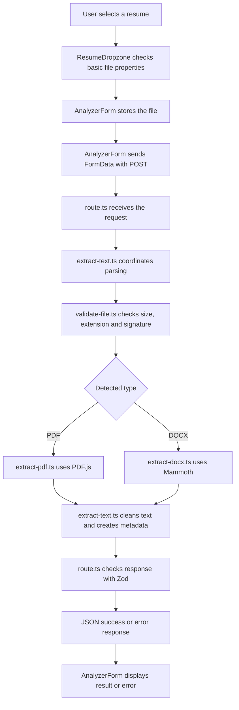

# Vett — Deep File-by-File Study Notes

> **Purpose:** A practical study guide for understanding what each important Vett file does, how it connects to other files, and what its main functions and expressions return. This is not a line-by-line explanation of every style class. It focuses on the implementation and concepts most useful for debugging and internship interviews.
>
> **Current scope:** The code shared for this guide implements the UI and PDF/DOCX resume-text extraction. AI-powered resume/job matching and an ATS-style score are planned features, not part of the parsing endpoint described here.

## Contents

1. [The whole application in one minute](#1-the-whole-application-in-one-minute)
2. [Frontend files](#2-frontend-files)
   - [`page.tsx`](#21-pagetsx)
   - [`layout.tsx`](#22-layouttsx)
   - [`AnalyzerForm.tsx`](#23-analyzerformtsx)
   - [`ResumeDropzone.tsx`](#24-resumedropzonetsx)
   - [`JobDescriptionInput.tsx`](#25-jobdescriptioninputtsx)
   - [`Header.tsx`](#26-headertsx)
   - [`ThemeToggle.tsx`](#27-themetoggletsx)
3. [Backend and document-processing files](#3-backend-and-document-processing-files)
   - [`route.ts`](#31-routets)
   - [`extract-text.ts`](#32-extract-textts)
   - [`validate-file.ts`](#33-validate-filets)
   - [`extract-pdf.ts`](#34-extract-pdfts)
   - [`extract-docx.ts`](#35-extract-docxts)
4. [Schemas, types, and helpers](#4-schemas-types-and-helpers)
   - [`resume-schema.ts`](#41-resume-schema)
   - [`constants.ts`](#42-constants)
   - [`formatters.ts`](#43-formatters)
   - [`modules.d.ts`](#44-module-declarations)
5. [Styles and configuration](#5-styles-and-configuration)
6. [Important concepts without the jargon overload](#6-important-concepts-without-the-jargon-overload)
7. [End-to-end flow and return-value cheat sheet](#7-end-to-end-flow-and-return-value-cheat-sheet)
8. [Interview-ready explanations](#8-interview-ready-explanations)
9. [Current limitations and planned work](#9-current-limitations-and-planned-work)

---

# 1. The whole application in one minute

Vett currently accepts a PDF or DOCX resume and extracts readable text from it. The job-description input is present in the UI, but the current `POST /api/parse-resume` request sends only the resume file; it does not yet send the job description for AI matching.

The current flow is:



A simple way to remember the responsibilities:

| Layer | Main responsibility | Main file |
|---|---|---|
| UI | Gather user input and show feedback | `AnalyzerForm.tsx` |
| HTTP API | Receive the request and return JSON/status codes | `route.ts` |
| Processing coordinator | Choose the parsing path, clean text and create metadata | `extract-text.ts` |
| File validation | Decide if the uploaded bytes look like an allowed file | `validate-file.ts` |
| Format-specific parsing | Read PDF or DOCX contents | `extract-pdf.ts`, `extract-docx.ts` |
| Response contract | Define what success and error objects must look like | `resume-schema.ts` |

This structure is an example of **separation of concerns**: each file has a specific job instead of putting all logic in one giant file.

# 2. Frontend files

## 2.1 page.tsx

**File:** `src/app/page.tsx`

### Purpose

`page.tsx` builds the main page users see. It composes the header, introductory copy, analyzer form, and footer. It is mostly a layout/composition file rather than a place for upload or parsing logic.

### Main code shape

```tsx
import { Header } from "@/components/Header";
import { AnalyzerForm } from "@/components/AnalyzerForm";

export default function Home() {
  return (
    <div>
      <Header />
      <main>
        {/* Introductory text */}
        <AnalyzerForm />
      </main>
      <footer>{/* Privacy note and copyright */}</footer>
    </div>
  );
}
```

### How it works

- Imports the reusable `Header` and `AnalyzerForm` components.
- Returns JSX describing the page structure.
- Uses layout and styling classes to control spacing, width, and responsive behavior.
- Includes product copy and the caveat that the future match score will be Vett's estimate, not an official employer ATS score.
- Shows a privacy statement. Treat that as a product promise that must stay consistent with actual production behavior and any future AI-provider processing.

### What does `Home()` return?

`Home()` returns a **React element tree** (the JSX describing the page). React/Next.js then renders that tree into the web page. It does not return the resume text or make the parsing API call.

### Interview takeaway

`page.tsx` is the page composition layer. It assembles components, while interactive state and request handling live in `AnalyzerForm.tsx` and its child components.

---

## 2.2 layout.tsx

**File:** `src/app/layout.tsx`

### Purpose

`layout.tsx` defines the shared HTML shell for the app. It imports global CSS, sets page metadata, and initializes the chosen theme early enough to reduce a visible light/dark-theme flash.

### Important pieces

```tsx
import type { Metadata } from "next";
import "./globals.css";

export const metadata: Metadata = {
  title: "Vett | Resume & Job Description Analyzer",
  description: "...",
};
```

- `import type` brings in a TypeScript type only; it is not a runtime JavaScript value.
- `metadata` gives Next.js the page title and description used by the browser and other consumers.
- Importing `globals.css` makes the global design tokens and Tailwind setup apply to the app.

The file also defines `themeInitScript`, a short browser script that reads `localStorage` and the operating system's dark-mode preference. It sets `data-theme` on the root `<html>` element before the UI is first painted when possible.

```tsx
export default function RootLayout({ children }: { children: React.ReactNode }) {
  return (
    <html lang="en" suppressHydrationWarning>
      <head>
        <script dangerouslySetInnerHTML={{ __html: themeInitScript }} />
      </head>
      <body>{children}</body>
    </html>
  );
}
```

- `children` means whatever page content is nested inside this shared layout.
- `RootLayout()` returns the app's outer HTML structure.
- `suppressHydrationWarning` suppresses a known class of hydration warning on the `<html>` element where the initial theme attribute may differ between server and browser. It should not be used as a general way to hide unrelated hydration bugs.
- `dangerouslySetInnerHTML` injects the fixed theme script string into the page. In the shared code, that script is a hard-coded constant rather than user-supplied resume text; do not put untrusted user content into this pattern.

### Important distinction

`layout.tsx` doesn't handle the file upload. It establishes the shell that surrounds the page and helps initialize theme appearance.

### Interview takeaway

The root layout is a shared App Router wrapper for metadata, global styles, HTML structure, and early theme initialization.

---

## 2.3 AnalyzerForm.tsx

**File:** `src/components/AnalyzerForm.tsx`

### Purpose

This is the central interactive component for the current workflow. It owns the form state, connects the upload and job-description inputs, submits the resume to the backend, and displays loading, error, or extraction-result UI.

### Client Component

The file starts with:

```tsx
"use client";
```

This marks it as a Next.js Client Component because it uses React state and browser interactions. It can still be pre-rendered on the server for the initial HTML, but its interactive JavaScript is also used in the browser.

### State variables

The component stores values such as:

```tsx
const [file, setFile] = useState<File | null>(null);
const [fileError, setFileError] = useState<string | null>(null);
const [jobDescription, setJobDescription] = useState("");
const [isLoading, setIsLoading] = useState(false);
const [apiError, setApiError] = useState<string | null>(null);
const [parseResult, setParseResult] = useState<ParseResumeSuccess | null>(null);
const [showFullPreview, setShowFullPreview] = useState(false);
```

Interpret them in plain English:

- `file`: the selected resume, or `null` when no file is selected.
- `fileError`: a client-side file-validation message, or `null` when there is no such message.
- `jobDescription`: the text currently entered in the textarea.
- `isLoading`: whether the parse request is in progress.
- `apiError`: an error received while requesting the API, or a network/server error.
- `parseResult`: the successful extraction response, or `null` before success/after reset.
- `showFullPreview`: whether the UI displays the full extracted text or only a short excerpt.

`useState(initialValue)` returns a two-item array: the current state value and a setter function. Calling the setter asks React to update the value and re-render the affected UI.

### Form validity

```tsx
const isJobDescriptionValid =
  jobDescription.trim().length >= MIN_JOB_DESCRIPTION_CHARS;

const isFormValid =
  file !== null && fileError === null && isJobDescriptionValid && !isLoading;
```

- `trim()` returns a new string without whitespace at the beginning/end.
- `.length` returns the number of characters in that trimmed string.
- `>=` checks whether the minimum length is reached.
- `&&` means every condition must be true.
- `!isLoading` means submission is allowed only when a request is not already in progress.

The minimum is a UI rule used to enable/disable the button. The current parsing API does **not** use the job description yet.

### `handleSubmit(e)`

The function is declared `async` because it awaits network and response operations. Its key operations are:

1. `e.preventDefault()` prevents the browser's normal form submission/page reload. It returns `undefined`.
2. It returns early if the form is invalid or the file is missing.
3. It sets loading to true and clears old errors/results.
4. It creates `new FormData()` and appends the file under the field name `resume`.
5. It calls `fetch("/api/parse-resume", { method: "POST", body: formData })`.
6. `fetch()` returns a `Promise<Response>`. `await` gives the `Response` object when the network response arrives.
7. `await res.json()` returns a Promise resolving to the parsed JSON value. The code treats that value as `ParseResumeSuccess | ParseResumeError` for TypeScript purposes.
8. It checks `!res.ok || !data.success`. If there's an error, it sets `apiError`; otherwise, it saves the parsed result with `setParseResult(data)`.
9. A `catch` handles network or response-parsing failures and displays a generic connection message.
10. `finally` always runs after the try/catch completes, so `setIsLoading(false)` clears the loading state on success or failure.

**Important:** In the current code, `FormData` appends only `resume`, not `jobDescription`. That is consistent with a parsing-only endpoint; sending the job description for actual matching is planned for a later phase.

### Other functions

- `handleReset()` sets `parseResult` and `apiError` to `null`. It returns `undefined`; it doesn't itself clear the file or job description.
- Inline callbacks passed to `ResumeDropzone` update file state and clear stale errors/results.
- Inline callbacks passed to `JobDescriptionInput` update the job description and clear stale result/error feedback.

### Conditional rendering

- If `isLoading` is true, the button shows a spinner and “Extracting Resume Text...”.
- If `apiError` has a value, an error banner appears.
- If `parseResult` has a value, the UI renders metadata and extracted text preview.
- `formatFileSize(...)` converts file size to a readable label.
- `toLocaleString()` returns a localized display string for word/character counts.
- `slice(0, 350)` returns the first 350 characters for the collapsed preview.

### What does `AnalyzerForm()` return?

It returns a React element tree containing the form and conditional success/error panels. It does not itself extract PDF text; it asks the backend to do that work.

### Interview takeaway

`AnalyzerForm` is the frontend workflow orchestrator: it owns state, submits the resume, handles the HTTP result, and decides which UI state to display.

---

## 2.4 ResumeDropzone.tsx

**File:** `src/components/ResumeDropzone.tsx`

### Purpose

This component handles choosing, dropping, replacing, and removing a resume. It performs quick client-side checks so a user gets immediate feedback before submitting the form.

### Props

Its props describe information it receives from the parent:

```tsx
interface ResumeDropzoneProps {
  file: File | null;
  onFileSelect: (file: File | null) => void;
  error: string | null;
  onError: (error: string | null) => void;
}
```

- `file` is the currently selected file.
- `onFileSelect` is a callback supplied by the parent.
- `error` is the current file error message.
- `onError` is a callback used to update that error in the parent.

The child doesn't own the canonical `file` value; it asks the parent to update it via callbacks. This keeps shared form state in `AnalyzerForm`.

### The two main hooks

```tsx
const inputRef = useRef<HTMLInputElement>(null);
const [isDragging, setIsDragging] = useState(false);
```

- `useRef` returns a persistent ref object with a `.current` property. Here it points to the hidden native file input so code can call `.click()` on it.
- `useState(false)` tracks whether the user is currently dragging a file over the dropzone.

### `validateFile(candidate)`

This function checks a selected `File` in the browser:

1. Converts the filename to lowercase with `.toLowerCase()`.
2. Uses `ALLOWED_RESUME_EXTENSIONS.some(...)` to see whether the name ends in `.pdf` or `.docx`.
   - `.some(callback)` returns a boolean: `true` if at least one extension matches.
3. Checks `candidate.size` against `MAX_RESUME_SIZE_BYTES`.
4. Rejects a size of zero.
5. Calls `onError(null)` and returns `true` if these checks pass; otherwise it sets an error and returns `false`.

`candidate.size` is provided by the browser's `File` object and is measured in bytes. These are UX checks, not a security boundary; the server repeats important validation because clients can be bypassed.

### `handleFile(candidate)`

- Calls `validateFile(candidate)`.
- If it returns `true`, calls `onFileSelect(candidate)`.
- If it returns `false`, calls `onFileSelect(null)`.

The function itself returns `undefined`; its effect is to notify the parent through callbacks.

### Drag-and-drop and native file picker handlers

- `onDragOver(e)`: calls `preventDefault()` to allow dropping and sets `isDragging` to `true`.
- `onDragLeave(e)`: prevents default behavior and sets `isDragging` to `false`.
- `onDrop(e)`: prevents browser navigation/open-file behavior, resets drag state, reads `e.dataTransfer.files`, and processes the first file if one exists.
- `onInputChange(e)`: reads `e.target.files`, processes the first selected file, then sets `e.target.value = ""` so selecting the same file again can fire a new change event.
- `handleKeyDown(e)`: when Enter or Space is pressed, prevents default behavior and opens the native picker through `inputRef.current?.click()`.
- `handleRemove()`: tells the parent to clear the file and error.
- `handleReplace()`: opens the native picker again.

Event-handler functions mostly return `undefined`; their purpose is performing actions and updating state/calling callbacks.

### Rendering

If `file` exists, the component shows a file summary and Replace/Remove buttons. If there is no file, it renders the drop area. CSS classes change based on dragging and error state. The SVG is decorative icon markup and doesn't contain parsing logic.

### Interview takeaway

`ResumeDropzone` isolates upload interactions and immediate validation. It reports changes to its parent through callbacks, while the server remains responsible for authoritative validation.

---

## 2.5 JobDescriptionInput.tsx

**File:** `src/components/JobDescriptionInput.tsx`

### Purpose

A controlled textarea for entering the job description. It displays a live character count and warns when the text is shorter than the configured minimum.

### Props

```tsx
interface JobDescriptionInputProps {
  value: string;
  onChange: (val: string) => void;
  disabled?: boolean;
}
```

- `value` is the current text owned by the parent.
- `onChange` is a callback the child calls when the text changes.
- `disabled` is optional; the component defaults it to `false`.

### Character count

```tsx
const charCount = value.trim().length;
const isTooShort = charCount > 0 && charCount < MIN_JOB_DESCRIPTION_CHARS;
```

`charCount` becomes a number. `isTooShort` becomes a boolean. Empty text is treated separately so the UI can show the minimum instruction rather than the “needs N more” warning.

### `handleChange(e)`

```tsx
function handleChange(e: ChangeEvent<HTMLTextAreaElement>) {
  onChange(e.target.value);
}
```

- `e` is the browser/React change event for the textarea.
- `e.target.value` is the new string in the text box.
- `onChange(...)` notifies `AnalyzerForm`, which updates its state.
- The function returns `undefined`.

The textarea is **controlled** because its `value` comes from props and changes are sent back via `onChange`.

### JSX details worth knowing

- `htmlFor` connects the `<label>` to the textarea's `id` for accessibility.
- `disabled={disabled}` disables editing while the parent says the form is loading.
- `aria-describedby` connects helper text to the field for assistive technology.
- The character counter displays `MIN_JOB_DESCRIPTION_CHARS - charCount` when more characters are required.

### Interview takeaway

`JobDescriptionInput` is a presentational controlled input. It calculates/display counts and reports new text to the parent; it doesn't call the backend itself.

---

## 2.6 Header.tsx

**File:** `src/components/Header.tsx`

### Purpose

A small presentation component showing the Vett wordmark, subtitle, and theme toggle.

### Main behavior

```tsx
import { ThemeToggle } from "./ThemeToggle";

export function Header() {
  return (
    <header>
      {/* Brand text and subtitle */}
      <ThemeToggle />
    </header>
  );
}
```

- The relative import `./ThemeToggle` refers to a file in the same components directory.
- `Header()` returns JSX (a React element tree).
- It doesn't manage form state or make API requests.
- Most of the remaining code is semantic HTML and Tailwind styling for alignment, borders, background, and responsive visibility.

### Interview takeaway

`Header` separates shared page branding/navigation from the main analyzer workflow and composes the reusable theme control.

---

## 2.7 ThemeToggle.tsx

**File:** `src/components/ThemeToggle.tsx`

### Purpose

Allows the user to choose light, dark, or system appearance. It persists the preference in `localStorage` and sets `data-theme` on the root HTML element so CSS variables can change.

### Theme type

```tsx
type ThemeMode = "light" | "dark" | "system";
```

This is a TypeScript union type: only one of these three string values is allowed where `ThemeMode` is expected.

### `subscribe(callback)`

This function subscribes to two browser events:

- A `storage` event, used here to notify subscribers when the saved preference changes.
- A `change` event on `matchMedia("(prefers-color-scheme: dark)")`, used when the OS theme preference changes.

It returns a **cleanup function** that removes both event listeners. Cleanup prevents the component from leaving stale listeners attached.

### `getSnapshot()`

- Reads `localStorage.getItem("vett-theme")`.
- Returns the stored value if it is exactly `"light"`, `"dark"`, or `"system"`.
- Returns `"system"` if the value is missing or invalid.

`localStorage.getItem(...)` returns a string or `null`; `getSnapshot()` returns a `ThemeMode` value.

### `getServerSnapshot()`

Returns `"system"`. This gives React a predictable theme snapshot during server rendering, where browser `localStorage` isn't available.

### `useSyncExternalStore(...)`

```tsx
const mode = useSyncExternalStore(subscribe, getSnapshot, getServerSnapshot);
```

This hook lets React subscribe to an external source of state. It returns the current `ThemeMode` snapshot. Here, the external state is the saved browser preference plus system appearance changes.

### `useEffect(...)`

The effect defines `applyTheme()` and calls it after render:

- If the preference is `system`, it checks `window.matchMedia(...).matches` and sets `data-theme` to `dark` or `light`.
- Otherwise, it sets `data-theme` to the selected explicit mode.

`document.documentElement.setAttribute(...)` returns `undefined`; its effect is modifying the `<html>` element. The effect also adds a media-query listener and returns a cleanup function that removes that listener. The dependency array `[mode]` makes the effect run when `mode` changes.

### `setTheme(newMode)`

- Saves the selected mode with `localStorage.setItem(...)`.
- Updates the `data-theme` attribute immediately.
- Dispatches a `storage` event to notify the external-store subscription in this tab.

`localStorage.setItem(...)` returns `undefined`. The `setTheme()` handler itself also returns `undefined`.

### `options.map(...)`

The `options` array defines the Light, Dark, and System buttons, each with its label and SVG icon. `options.map(...)` returns a **new array of React elements**, one button for each option. The `key={opt.id}` helps React track each item.

### Interview takeaway

`ThemeToggle` stores the user preference and updates a root `data-theme` attribute. CSS variables in `globals.css` then change the appearance without every component needing its own color state.

---

# 3. Backend and document-processing files

## 3.1 route.ts

**File:** `src/app/api/parse-resume/route.ts`

### Purpose

This is the Next.js API route for `POST /api/parse-resume`. It receives the uploaded file, calls the extraction pipeline, validates the success response with Zod, and returns JSON with an HTTP status code.

### Main function: `POST(req)`

```ts
export async function POST(req: NextRequest) {
  try {
    const formData = await req.formData();
    const file = formData.get("resume");
    // ...
  } catch (err: unknown) {
    // ...
  }
}
```

Next.js invokes this named handler for a POST request to this route. Because it is `async`, the handler returns a `Promise` that eventually resolves to a `NextResponse`.

### `await req.formData()`

- `req` is the incoming `NextRequest`.
- `req.formData()` returns a `Promise<FormData>`.
- `await` gives the resolved `FormData` object.
- `formData.get("resume")` returns the value under that field name, or `null` if it doesn't exist. The value can be a `File` or a string, so the code checks its type before using it as a file.

### File check

```ts
if (!file || !(file instanceof File)) {
  // return NO_FILE with status 400
}
```

This checks whether a value exists and whether it is a `File` instance. It doesn't yet check if the file is a valid PDF/DOCX; that happens in `validate-file.ts`.

`NextResponse.json(errorResponse, { status: 400 })` returns a `NextResponse` object containing a JSON body and status 400. It doesn't return a plain JavaScript object by itself.

### Convert to bytes

```ts
const arrayBuffer = await file.arrayBuffer();
const buffer = new Uint8Array(arrayBuffer);
```

- `file.arrayBuffer()` returns a `Promise<ArrayBuffer>`.
- After `await`, `arrayBuffer` holds the file bytes in raw buffer form.
- `new Uint8Array(arrayBuffer)` creates a typed-array view that can index the bytes as numbers from 0 to 255. The constructor returns a `Uint8Array` object.

### Call the coordinator

```ts
const result = await extractResumeText(file.name, buffer);
```

`extractResumeText(...)` returns a `Promise<ExtractResumeResult>`. After `await`, `result` has the shape `{ text, metadata }`.

### Build and validate the response

```ts
const payload = {
  success: true,
  text: result.text,
  metadata: result.metadata,
};

const parseCheck = ParseResumeSuccessSchema.safeParse(payload);
```

`payload` is a new object that adds the required `success: true` flag to the extraction output. `safeParse(payload)` returns a result object:

- Success: `{ success: true, data: validatedData }`.
- Failure: `{ success: false, error: ZodError }`.

This Zod `success` flag describes whether validation passed. It is not the same field as the `success: true` inside `payload`.

If validation fails, the code logs `path`, `code`, and `message` for each Zod issue using `.map(...)` and `JSON.stringify(..., null, 2)`. It does not log the extracted resume text. The route returns a generic error response with status 500.

If validation succeeds, it returns:

```ts
return NextResponse.json(parseCheck.data, { status: 200 });
```

`parseCheck.data` is the validated output object. `NextResponse.json(...)` creates the HTTP response.

### `catch` behavior

The route catches failures thrown inside the `try` block:

- If `err instanceof ResumeParseError`, it returns the custom message and code with status 400 in the current implementation.
- Other errors return a generic `PARSE_FAILED` response with status 500.

**Current implementation detail to be aware of:** This catch branch returns status 400 for every `ResumeParseError`, including one whose code is `PARSE_FAILED`. The earlier schema-validation failure returns 500 directly. Status mapping could be refined later so internal parsing-engine failures are consistently treated as server failures.

### Interview takeaway

The API route is the HTTP boundary. It parses the request, delegates document work, validates its response shape, and communicates outcomes through JSON plus HTTP status codes.

---

## 3.2 extract-text.ts

**File:** `src/lib/resume/extract-text.ts`

### Purpose

This is the coordinator for resume processing. It validates the file, chooses the correct format-specific parser, normalizes extracted text, limits output length, calculates metadata, and returns the final object.

### Types and error class

```ts
export interface ExtractResumeResult {
  text: string;
  metadata: ResumeMetadata;
}
```

This interface describes the return object's shape. It is a TypeScript-only contract; by itself it doesn't check data at runtime.

```ts
export class ResumeParseError extends Error {
  code: "EMPTY_FILE" | "FILE_TOO_LARGE" | "UNSUPPORTED_FORMAT" |
        "CORRUPTED_FILE" | "ENCRYPTED_PDF" | "SCANNED_PDF" | "PARSE_FAILED";

  constructor(message: string, code: /* same allowed codes */) {
    super(message);
    this.name = "ResumeParseError";
    this.code = code;
  }
}
```

`ResumeParseError` is a custom error object used to carry both a readable message and a machine-readable code.

- `extends Error` inherits standard JavaScript error behavior.
- `constructor(...)` runs when someone creates the error.
- `super(message)` initializes the parent `Error` with the message.
- `this.name` labels the error type.
- `this.code = code` stores the category.
- `new ResumeParseError(...)` returns a new error instance; `throw` raises it and stops the current path until it is handled.

### Text limit

```ts
export const MAX_EXTRACTED_RESUME_CHARS = 100_000;
```

This constant means extracted text is capped at 100,000 characters. The underscores are just number separators for readability; the value is 100000.

### Main function: `extractResumeText(fileName, buffer)`

Its signature is:

```ts
export async function extractResumeText(
  fileName: string,
  buffer: Uint8Array
): Promise<ExtractResumeResult>
```

Inputs:

- `fileName`: the uploaded file's name.
- `buffer`: the file bytes.

Return: a `Promise` that resolves to `{ text, metadata }` if successful. It rejects if an error is thrown.

#### Step A — capture the file size

```ts
const fileSize = buffer.length;
```

`buffer.length` returns a number: the count of bytes in the typed array. The code captures it before parsing because PDF.js may transfer/detach the byte buffer internally. Saving the number first protects the metadata from the earlier detachment bug.

#### Step B — validate the file

```ts
const validation = validateResumeBuffer(fileName, buffer);
```

`validateResumeBuffer(...)` returns a `FileValidationResult` object, such as `{ valid: true, fileType: "pdf" }` or `{ valid: false, error, code }`.

If `validation.valid` is false or `fileType` is missing, the function throws `ResumeParseError`. That stops this function from moving on to a parser. This first validation check is outside the parser `try/catch` below, so the error bubbles up to the API route's `catch`.

#### Step C — prepare parsing variables

```ts
const fileType: DetectedFileType = validation.fileType;
let rawText = "";
let pageCount: number | undefined;
```

- `fileType` is the detected type, either `pdf` or `docx`.
- `rawText` starts empty; the parser result will be assigned to it.
- `pageCount` can contain a number or `undefined`, because only the current PDF parser returns a page count.

#### Step D — call the correct parser

```ts
if (fileType === "pdf") {
  const pdfResult = await extractPdfText(buffer);
  rawText = pdfResult.text;
  pageCount = pdfResult.pageCount;
} else if (fileType === "docx") {
  const docxResult = await extractDocxText(buffer);
  rawText = docxResult.text;
}
```

- `extractPdfText(buffer)` returns a `Promise<PdfExtractionResult>`. After `await`, `pdfResult` contains `{ text, pageCount }`.
- `extractDocxText(buffer)` returns a `Promise<DocxExtractionResult>`. After `await`, `docxResult` contains `{ text }`.

The coordinator doesn't need to know how PDF.js or Mammoth works internally. It only needs to know what each parser returns.

#### Step E — normalize parser errors

```ts
catch (err: unknown) {
  if (err instanceof PdfExtractionError || err instanceof DocxExtractionError) {
    throw new ResumeParseError(err.message, err.code);
  }
  throw new ResumeParseError(
    "An unexpected error occurred while parsing the document.",
    "PARSE_FAILED"
  );
}
```

Known parser errors are caught and converted into the common `ResumeParseError` class. Unexpected errors become a generic `PARSE_FAILED` error. The code uses `instanceof` to check the error's class.

#### Step F — clean and bound text

```ts
const cleanText = rawText.replace(/\r\n/g, "\n").trim();
const boundedText = cleanText.length > MAX_EXTRACTED_RESUME_CHARS
  ? cleanText.slice(0, MAX_EXTRACTED_RESUME_CHARS)
  : cleanText;
```

- `.replace(...)` returns a new string with matching line endings replaced.
- `.trim()` returns a new string without leading/trailing whitespace.
- `.length` returns the number of characters in the string.
- The ternary `condition ? valueIfTrue : valueIfFalse` acts like a compact `if/else`.
- `.slice(0, 100_000)` returns the first 100,000 characters if the text is too long; otherwise the entire cleaned string is used.

The result is called `boundedText` because its length cannot exceed the configured cap.

#### Step G — compute counts

```ts
const charCount = boundedText.length;
const wordCount = boundedText.split(/\s+/).filter(Boolean).length;
```

- `boundedText.length` returns a number.
- `.split(/\s+/)` returns an array of string pieces separated by one or more whitespace characters.
- `.filter(Boolean)` returns a new array excluding falsy items such as empty strings.
- `.length` on that array returns the number of pieces, used as the word count.

This is a practical whitespace-based count, not a language-perfect word tokenizer.

#### Step H — return the result

```ts
return {
  text: boundedText,
  metadata: {
    fileName,
    fileType,
    fileSize,
    charCount,
    wordCount,
    ...(pageCount ? { pageCount } : {}),
  },
};
```

This returns the final object:

- `text`: cleaned and capped extracted text.
- `metadata.fileName`: original filename.
- `metadata.fileType`: `pdf` or `docx`.
- `metadata.fileSize`: captured original byte count.
- `metadata.charCount`: number of characters in `boundedText`.
- `metadata.wordCount`: whitespace-based word count.
- `metadata.pageCount`: included for a PDF when a page count exists.

`...(pageCount ? { pageCount } : {})` conditionally spreads either an object containing `pageCount` or an empty object into metadata. Since valid PDF page counts are positive, the current PDF path includes it. A more explicit optional check could be `pageCount !== undefined`, but the current expression works for positive page counts.

### Interview takeaway

`extract-text.ts` coordinates the parsing workflow and returns a normalized text string plus metadata. It delegates format-specific work to separate parser files and raises a consistent error type when something fails.

---

## 3.3 validate-file.ts

**File:** `src/lib/resume/validate-file.ts`

### Purpose

Checks whether the uploaded bytes appear to be an acceptable PDF or DOCX before spending resources parsing them.

### Types

```ts
type DetectedFileType = "pdf" | "docx";
```

This union type limits the detected file type to the two formats supported by the MVP.

```ts
interface FileValidationResult {
  valid: boolean;
  fileType?: DetectedFileType;
  error?: string;
  code?: /* allowed validation codes */;
}
```

This interface describes the shape of the validation result. Optional `?` fields may be absent. A valid result normally has `valid: true` and `fileType`; an invalid result has `valid: false` plus an error message/code.

### Main function: `validateResumeBuffer(fileName, buffer)`

Inputs:

- `fileName`: filename supplied by the upload.
- `buffer`: bytes representing the file.

Return: a `FileValidationResult` object. It doesn't throw for the normal expected invalid-file conditions; it returns an object explaining the failure.

#### Check 1 — empty file

```ts
if (!buffer || buffer.length === 0) { ... }
```

If the buffer is absent or its length is zero, returns an invalid result with code `EMPTY_FILE`.

#### Check 2 — file size

```ts
if (buffer.length > MAX_RESUME_SIZE_BYTES) { ... }
```

`buffer.length` returns a number of bytes. If it exceeds the 4 MiB limit, the function returns `FILE_TOO_LARGE`. `formatFileSize(buffer.length)` returns a human-readable string such as `5.2 MB` for the error message.

#### Check 3 — extension

```ts
const lowerName = fileName.toLowerCase();
const isPdfExt = lowerName.endsWith(".pdf");
const isDocxExt = lowerName.endsWith(".docx");
```

- `.toLowerCase()` returns a lowercase copy of the filename, making the check case-insensitive.
- `.endsWith(...)` returns a boolean.

If neither extension matches, the function returns `UNSUPPORTED_FORMAT`. The old `.doc` format is not supported.

#### Check 4 — magic bytes

PDF signature check compares the first four bytes against `%PDF`:

```ts
buffer[0] === 0x25 && buffer[1] === 0x50 &&
buffer[2] === 0x44 && buffer[3] === 0x46
```

DOCX files are ZIP containers and the expected opening signature checked here is `PK\x03\x04` (`50 4B 03 04` in hex).

If the extension says PDF but the bytes don't match, it returns `CORRUPTED_FILE`. If the extension says DOCX but the signature doesn't match, it returns `UNSUPPORTED_FORMAT` in the current code.

If extension and signature match, it returns a short success result:

```ts
{ valid: true, fileType: "pdf" }
```

or

```ts
{ valid: true, fileType: "docx" }
```

**Important limitation:** matching four starting bytes is a useful first check, but it does not prove that the whole document is structurally valid or harmless. PDF.js/Mammoth still need to parse it successfully. The `.docx` signature check only confirms a ZIP-like header; Mammoth checks whether its content can actually be read as a DOCX.

### Interview takeaway

The server validates size, extension, and file signature instead of trusting the filename or browser. It returns a structured result instead of throwing for expected validation failures.

---

## 3.4 extract-pdf.ts

**File:** `src/lib/resume/extract-pdf.ts`

### Purpose

Contains the PDF.js-specific logic. It loads the PDF parser in the Node.js server environment, extracts text page by page, returns a page count, and classifies common PDF errors.

### Result interface and error class

```ts
export interface PdfExtractionResult {
  text: string;
  pageCount: number;
}
```

Successful extraction returns text and page count.

`PdfExtractionError` extends the built-in `Error` and adds one allowed `code`: `ENCRYPTED_PDF`, `SCANNED_PDF`, `CORRUPTED_FILE`, or `PARSE_FAILED`. Its constructor returns an instance with `message`, `name`, and `code` set.

### Main function: `extractPdfText(buffer)`

Input: a `Uint8Array` of PDF bytes.

Return: `Promise<PdfExtractionResult>`, which resolves to `{ text, pageCount }` or rejects by throwing `PdfExtractionError`.

#### Step A — initialize PDF.js

```ts
await import("pdfjs-dist/legacy/build/pdf.worker.mjs");
pdfjs = await import("pdfjs-dist/legacy/build/pdf.mjs");
```

These are dynamic imports, so each returns a Promise. `await` waits for the module to load. Importing the worker bundle first registers the worker handler in memory for the Node.js/fake-worker setup used here.

If initialization throws, the `catch` logs a developer diagnostic and throws a `PdfExtractionError` with `PARSE_FAILED`.

#### Step B — copy the bytes

```ts
const uint8Data = new Uint8Array(buffer.slice());
```

`buffer.slice()` returns a copy of the typed-array contents. `new Uint8Array(...)` creates a new typed-array object from that copy. This gives PDF.js an isolated buffer instead of sharing the caller's underlying buffer, protecting the original from detachment during worker transfer.

#### Step C — create the PDF loading task

```ts
const loadingTask = pdfjs.getDocument({
  data: uint8Data,
  useSystemFonts: true,
  disableFontFace: true,
  standardFontDataUrl: "node_modules/pdfjs-dist/standard_fonts/",
  cMapUrl: "node_modules/pdfjs-dist/cmaps/",
  cMapPacked: true,
});
doc = await loadingTask.promise;
```

- `pdfjs.getDocument(...)` returns a loading-task object.
- `loadingTask.promise` is a Promise that resolves to a PDF.js document proxy when loading succeeds.
- `await loadingTask.promise` gives us `doc`.

The options configure how the server parser handles fonts and CMaps (character maps). These paths/configurations are runtime-sensitive and should be rechecked if deployment packaging changes.

If document loading fails, the code examines error text/name and maps it to a more useful error code:

- Password/encryption-related → `ENCRYPTED_PDF`.
- Recognized invalid-structure errors → `CORRUPTED_FILE`.
- Other loading failures → `PARSE_FAILED`.

The catch also logs the error to the server terminal. It does not send the raw stack to the client.

#### Step D — loop through pages

```ts
const numPages = doc.numPages;
const pageTexts: string[] = [];

for (let i = 1; i <= numPages; i++) {
  const page = await doc.getPage(i);
  const textContent = await page.getTextContent();
  // read text items and add page text
}
```

- `doc.numPages` is a number.
- `doc.getPage(i)` returns a Promise resolving to a page proxy.
- `page.getTextContent()` returns a Promise resolving to an object whose `items` array contains extracted text/layout items.
- `.map(...)` transforms text items into strings, using `item.str` when it is a string and `""` otherwise.
- `.join(" ")` combines item strings into one string with spaces.
- `.trim()` removes outer whitespace.
- Non-empty page strings are pushed into `pageTexts`.

The page-level `catch` is empty except for a comment: if a page fails during text extraction, the current code skips that page and continues. That is a resilience choice, but it also means some page-level errors are intentionally not reported to the user.

After the loop, `pageTexts.join("\n\n")` returns one combined string with two newlines between pages.

#### Step E — detect PDFs with no extractable text

```ts
const alphaNumericChars = fullText.replace(/[^a-zA-Z0-9]/g, "");
if (alphaNumericChars.length < 10) {
  throw new PdfExtractionError("...scanned or image-only...", "SCANNED_PDF");
}
```

- `.replace(/[^a-zA-Z0-9]/g, "")` returns a string with non-ASCII letters/digits removed.
- `.length` returns how many alphanumeric characters remain.
- If there are fewer than 10, the parser treats the document as having no sufficient extractable text and throws `SCANNED_PDF`.

This is a heuristic, not full OCR detection. A short text-based PDF could also fall below the threshold. OCR is not implemented in the current MVP.

#### Step F — successful return

```ts
return {
  text: fullText,
  pageCount: numPages,
};
```

The function returns the combined extracted text and the document's page count.

### Interview takeaway

`extract-pdf.ts` isolates PDF.js configuration and PDF-specific failure handling from the rest of the app. Its main function resolves to `{ text, pageCount }` or throws a typed extraction error.

---

## 3.5 extract-docx.ts

**File:** `src/lib/resume/extract-docx.ts`

### Purpose

Uses Mammoth to get plain text from a modern Word `.docx` document. DOCX files are OpenXML documents stored in a ZIP-based package, so they require different parsing logic from PDFs.

### Result and error types

```ts
export interface DocxExtractionResult {
  text: string;
}
```

A successful result has a `text` string.

`DocxExtractionError` extends `Error` and attaches `CORRUPTED_FILE` or `PARSE_FAILED` as a code.

### Main function: `extractDocxText(buffer)`

Input: `Uint8Array` bytes.

Return: `Promise<DocxExtractionResult>`, resolving to `{ text }` or rejecting with a `DocxExtractionError`.

### Step A — create a Node Buffer

```ts
const nodeBuffer = Buffer.from(buffer);
```

`Buffer.from(...)` returns a Node.js `Buffer`, which is a byte container compatible with many Node libraries. This conversion is used because Mammoth's API expects a buffer-like input.

### Step B — ask Mammoth to extract raw text

```ts
const result = await mammoth.extractRawText({ buffer: nodeBuffer });
const text = result.value.trim();
```

- `mammoth.extractRawText(...)` returns a Promise resolving to a Mammoth result object. The result includes `value` (the extracted text) and `messages` (warnings/messages from conversion).
- `await` gives that object.
- `result.value.trim()` returns the extracted string with leading/trailing whitespace removed.

Vett uses `value` and doesn't currently display or store Mammoth's `messages`.

### Step C — reject empty or near-empty text

```ts
if (!text || text.replace(/[^a-zA-Z0-9]/g, "").length < 5) {
  throw new DocxExtractionError("The DOCX document contains no readable text content.", "PARSE_FAILED");
}
```

The first part checks for an empty string. The second strips characters other than English letters/digits and checks whether at least five remain. If the check fails, it throws a custom error.

### Step D — return text or map an error

```ts
return { text };
```

This returns the `DocxExtractionResult` object.

The catch block rethrows known `DocxExtractionError` instances unchanged. Other exceptions are converted to a generic error saying the DOCX may be corrupted or password-protected, with code `CORRUPTED_FILE`.

**Caveat:** That generic mapping is simple but may classify some unexpected library/runtime failures as file corruption. It could be refined later if better diagnostics are needed.

### Interview takeaway

`extract-docx.ts` wraps Mammoth's raw-text extraction in a small function with a consistent return shape and typed errors.

---

# 4. Schemas, types, and helpers

## 4.1 Resume schema

**File:** `src/lib/validation/resume-schema.ts`

### Purpose

Defines the Zod runtime schemas and derives TypeScript types from those schemas. This file describes the structure that a successful parse response or a parse error should have.

### Metadata schema

```ts
export const ResumeMetadataSchema = z.object({
  fileName: z.string().min(1, "File name cannot be empty"),
  fileType: z.enum(["pdf", "docx"]),
  fileSize: z.number().int().positive("File size must be positive"),
  charCount: z.number().int().nonnegative(),
  wordCount: z.number().int().nonnegative(),
  pageCount: z.number().int().positive().optional(),
});
```

What these methods mean:

- `z.object({...})`: expects an object with the listed fields.
- `z.string()`: the value must be a string.
- `.min(1)`: string length must be at least 1.
- `z.enum([...])`: value must be one of the listed strings.
- `z.number()`: value must be a number.
- `.int()`: the number must be an integer.
- `.positive()`: the number must be greater than zero.
- `.nonnegative()`: the number must be zero or greater.
- `.optional()`: the field may be omitted; if it is present, it must satisfy the other rules.

`pageCount` is optional because the current DOCX result doesn't include page count. The PDF parser does.

### Success and error schemas

```ts
export const ParseResumeSuccessSchema = z.object({
  success: z.literal(true),
  text: z.string().min(1, "Extracted text cannot be empty"),
  metadata: ResumeMetadataSchema,
});
```

`z.literal(true)` means that the field must be exactly the boolean `true`.

The error schema requires `success: false`, an error message, and a code from the allowed list such as `NO_FILE`, `FILE_TOO_LARGE`, `SCANNED_PDF`, or `PARSE_FAILED`.

### `safeParse(payload)` — what does it return?

`safeParse()` checks a real object at runtime and returns a result object rather than throwing a normal validation exception:

- Valid payload: `{ success: true, data: parsedAndValidatedValue }`.
- Invalid payload: `{ success: false, error: ZodError }`.

That is why the API route can write `if (!parseCheck.success)` and inspect `parseCheck.error.issues`.

### `z.infer`

```ts
export type ResumeMetadata = z.infer<typeof ResumeMetadataSchema>;
export type ParseResumeSuccess = z.infer<typeof ParseResumeSuccessSchema>;
export type ParseResumeError = z.infer<typeof ParseResumeErrorSchema>;
```

`z.infer<typeof ...>` creates a TypeScript type from a schema. The schema runs at runtime; the inferred type helps TypeScript check the code during development/build. Types alone do not validate incoming HTTP data at runtime.

### Interview takeaway

`resume-schema.ts` keeps the response contract in one place. Zod checks actual values at runtime, while `z.infer` provides matching compile-time types.

---

## 4.2 Constants

**File:** `src/lib/constants.ts`

### Purpose

Stores repeated configuration values in one place so components and backend utilities don't each invent their own values.

Important constants include:

- `MAX_RESUME_SIZE_BYTES = 4 * 1024 * 1024`: 4 MiB in bytes.
- `MAX_RESUME_SIZE_LABEL = "4 MiB"`: readable UI label.
- `ALLOWED_RESUME_EXTENSIONS = [".pdf", ".docx"] as const`: allowed filename endings.
- `ALLOWED_RESUME_MIME_TYPES`: MIME types used by client-side file selection filtering.
- `MIN_JOB_DESCRIPTION_CHARS = 50`: minimum job-description length used by the UI.

`export const` makes each value available to importers. `as const` tells TypeScript to treat array entries as literal values rather than widening them to arbitrary strings.

### Why use constants?

Without a shared constant, the UI could say 4 MiB while backend validation allows a different value. A central value reduces inconsistency.

### Interview takeaway

`constants.ts` centralizes shared values such as limits and allowed formats, making them easier to maintain.

---

## 4.3 Formatters

**File:** `src/lib/formatters.ts`

### Purpose

Contains small display helpers. The shared function converts a byte count into a readable file-size label.

```ts
export function formatFileSize(bytes: number): string {
  if (bytes < 1024) return `${bytes} B`;
  const kb = bytes / 1024;
  if (kb < 1024) return `${kb.toFixed(1)} KB`;
  const mb = kb / 1024;
  return `${mb.toFixed(2)} MB`;
}
```

### What does it return?

It returns a **string**, not a number:

- Below 1024 bytes: e.g. `"800 B"`.
- From 1024 bytes up to just under 1 MiB: e.g. `"12.5 KB"`.
- 1 MiB or more: e.g. `"1.24 MB"`.

`toFixed(1)` returns a string with one digit after the decimal point; `toFixed(2)` returns a string with two decimal places. Divisions create numeric KB/MB values, and template strings combine them with units.

This function is for display; it does not validate whether a file is allowed.

### Interview takeaway

A formatter separates presentation formatting from the main validation and parsing logic.

---

## 4.4 Module declarations

**File:** `src/types/modules.d.ts`

### Purpose

Provides ambient TypeScript module declarations for imports where the project needs to supply type information. The shared file declares a basic shape for `mammoth` and a declaration for the PDF.js worker module.

### Mammoth declaration

It describes the result returned by Mammoth's raw text extraction:

- `value: string` — extracted text.
- `messages: Array<{ type: string; message: string }>` — messages/warnings.

It also describes an input object with an optional `buffer`, `path`, and the `extractRawText(...)` function returning a Promise of the result shape.

### PDF worker declaration

```ts
declare module "pdfjs-dist/legacy/build/pdf.worker.mjs" {
  const content: unknown;
  export default content;
}
```

This tells TypeScript that the module path exists and has a default export whose type is `unknown`.

A `.d.ts` file is only for type information. It doesn't run the parser or add runtime behavior. If a future version of a library ships official types or changes its API, this declaration may need to be revisited.

### Interview takeaway

Ambient module declarations fill TypeScript typing gaps for dependencies; they don't replace the dependency or implement its runtime behavior.

---

# 5. Styles and configuration

> Configuration can change as the project evolves. Use your current local files as the final source of truth for exact versions and settings.

## 5.1 `src/app/globals.css`

### Purpose

Defines global theme variables and configures Tailwind CSS v4 theme tokens.

The stylesheet declares CSS custom properties for light and dark mode, including background, surfaces, text, borders, accent, success, warning, and error colors. It then maps them inside `@theme` to semantic Tailwind color names such as `bg-surface`, `text-foreground`, `border-border`, and `bg-accent`.

This means a component can use a semantic name instead of hard-coding a color value. When the `data-theme` attribute changes from light to dark, the variable values change and the same component classes get different colors.

Other rules style the page background and provide the `.sr-only` utility pattern for content that should be visually hidden while remaining accessible to screen readers.

### Return values

CSS doesn't contain JavaScript functions to return data in this file. It defines styling rules that the browser applies to matching elements.

### Interview takeaway

CSS custom properties and semantic Tailwind tokens centralize theme colors and keep styling consistent across components.

---

## 5.2 `package.json`

### Purpose

Describes the Node project: package name, scripts, and dependency declarations.

Common scripts in this project include:

- `npm run dev`: starts the local Next.js development server.
- `npm run build`: creates the production build.
- `npm start`: runs the production server after a build.
- `npm run lint`: runs ESLint.

`dependencies` lists packages needed by the app at runtime; `devDependencies` lists tooling used during development/build. Exact versions can change, so refer to your live `package.json` and lockfile before claiming exact versions in an interview.

### Important

A successful build or lint check doesn't prove every real user scenario works. Manually test valid PDF/DOCX files and invalid/oversized files too.

---

## 5.3 `next.config.ts`

### Purpose

Provides configuration for Next.js. In the current Vett architecture, the important PDF.js-related setting is `serverExternalPackages: ["pdfjs-dist"]`, which tells Next.js to keep PDF.js external from the usual server bundling path so its Node.js runtime behavior and worker loading can work as expected.

The PDF.js worker issue previously showed why this file matters: a library may behave differently when run inside a bundled Next.js route than when imported directly in Node.js.

### Return values

The configuration module exports an object consumed by Next.js at build/runtime. It isn't a function called for each request.

---

## 5.4 `tsconfig.json`

### Purpose

Configures TypeScript's checks and module resolution.

Important settings in the project include strict type-checking, JSX support, and the `@/*` path alias pointing into `src/*`. That alias is why code can import from `@/lib/...` instead of using long relative paths such as `../../lib/...`.

`npx tsc --noEmit` asks TypeScript to check the project without emitting JavaScript files.

### Interview takeaway

`tsconfig.json` controls TypeScript compilation/type-checking behavior and path aliases; it is not part of the resume-processing logic itself.

---

## 5.5 `postcss.config.mjs`

### Purpose

Configures PostCSS to use `@tailwindcss/postcss`, the processing plugin for the project's Tailwind CSS v4 setup.

It exports a small configuration object. It doesn't run as part of each API request.

---

## 5.6 `eslint.config.mjs`

### Purpose

Configures ESLint using Next.js core web vitals and TypeScript rules, and ignores generated folders such as `.next`, `out`, and `build`.

ESLint catches code-quality and common mistake patterns. It does not execute the full application or prove runtime behavior.

---

# 6. Important concepts without the jargon overload

## `File` vs. `FormData`

- `File` is a runtime object representing an uploaded file. In `route.ts`, `file instanceof File` checks whether the field value is a file object.
- `FormData` is a container for named form fields sent in a request. Vett stores the resume under the field name `resume` and retrieves it with `formData.get("resume")`.

## `ArrayBuffer` vs. `Uint8Array`

- `ArrayBuffer` is raw binary storage.
- `Uint8Array` is an indexed view of bytes, where each element is from 0 to 255.
- Vett uses `file.arrayBuffer()` to read the file and wraps it with `new Uint8Array(...)` so validators and parsers can inspect the bytes.

## `async`, `await`, and `Promise`

An asynchronous function often returns a `Promise`, which represents a result that will arrive later. `await` waits for that Promise to settle and gives the resolved value inside an `async` function. If the Promise rejects by throwing, execution can jump to a surrounding `catch`.

Examples from Vett:

- `file.arrayBuffer()` → `Promise<ArrayBuffer>`.
- `extractPdfText(buffer)` → `Promise<PdfExtractionResult>`.
- `extractResumeText(fileName, buffer)` → `Promise<ExtractResumeResult>`.
- `fetch(...)` → `Promise<Response>`.

## TypeScript type vs. runtime validation

A TypeScript interface/type helps the compiler catch mistakes while developing. It is erased from the compiled JavaScript and does not inspect untrusted data by itself.

Zod schemas are executable JavaScript that can check actual values at runtime. `safeParse()` returns an object indicating success/failure and either the parsed data or validation error details.

## `throw`, custom errors, and `catch`

- `throw error` raises an error and stops the normal flow at that point.
- `catch` handles an error thrown inside the associated `try` block.
- `instanceof ResumeParseError` checks whether the caught error was created from the custom class (or its inheritance chain).
- The custom error's `message` is for humans; `code` is a stable category the application can branch on.

## `map`, `filter`, `split`, and `JSON.stringify`

- `array.map(callback)` returns a new array containing the callback result for every element.
- `array.filter(callback)` returns a new array containing only elements for which the callback is truthy.
- `string.split(separator)` returns an array of substrings.
- `JSON.stringify(value, null, 2)` converts data to formatted JSON text, indenting by two spaces. Vett uses it to make Zod issues readable in the server log.

## HTTP status codes in the current route

- `200`: parsing succeeded and a validated JSON result is returned.
- `400`: missing file and `ResumeParseError` cases in the current implementation.
- `500`: response-schema validation failure or unexpected unclassified errors.

There is a potential cleanup opportunity: the catch currently maps all `ResumeParseError` errors to 400 even if the code is `PARSE_FAILED`. Be accurate about current behavior; do not claim that every internal parser failure is already mapped to 500.

---

# 7. End-to-end flow and return-value cheat sheet

## Main flow

1. `ResumeDropzone` lets the user choose/drop a file and performs quick browser-side checks.
2. `AnalyzerForm` stores the file, builds `FormData`, and sends `POST /api/parse-resume`.
3. `route.ts` reads the form data, checks that `resume` is a `File`, converts it to `Uint8Array`, and calls `extractResumeText()`.
4. `extractResumeText()` stores the original size and calls `validateResumeBuffer()`.
5. If valid, the coordinator calls `extractPdfText()` or `extractDocxText()`.
6. The parser returns text (and page count for PDF). `extract-text.ts` normalizes text, applies the character cap, and calculates metadata.
7. `route.ts` builds a complete success payload and checks it with `ParseResumeSuccessSchema.safeParse()`.
8. `route.ts` returns `200` JSON on success or an error response on failure.
9. `AnalyzerForm` checks the response and displays the extraction card or an error message.

## Function return values

| Call / expression | Returns |
|---|---|
| `Header()` | JSX / React element tree |
| `Home()` in `page.tsx` | JSX / React element tree |
| `RootLayout({ children })` | JSX / React element tree for the shared shell |
| `useState(initial)` | Pair: current value and setter function |
| `useRef(initial)` | Persistent ref object with `.current` |
| `validateFile(candidate)` | Boolean `true` / `false` |
| `validateResumeBuffer(name, buffer)` | `FileValidationResult` object |
| `formatFileSize(bytes)` | Human-readable string such as `"100.0 KB"` |
| `file.arrayBuffer()` | `Promise<ArrayBuffer>` |
| `new Uint8Array(arrayBuffer)` | `Uint8Array` object containing/indexing bytes |
| `extractPdfText(buffer)` | `Promise<{ text, pageCount }>` |
| `extractDocxText(buffer)` | `Promise<{ text }>` |
| `extractResumeText(name, buffer)` | `Promise<{ text, metadata }>` |
| `rawText.replace(...)` | New string with replacements applied |
| `string.trim()` | New trimmed string |
| `string.slice(start, end)` | Portion of a string |
| `string.split(...)` | Array of substrings |
| `array.filter(...)` | New filtered array |
| `array.map(...)` | New transformed array |
| `ParseResumeSuccessSchema.safeParse(payload)` | Zod result object with either `data` or `error` |
| `req.formData()` | `Promise<FormData>` |
| `formData.get("resume")` | Field value (`File`/string) or `null` |
| `fetch(url, options)` | `Promise<Response>` |
| `res.json()` | `Promise` resolving to parsed response-body data |
| `NextResponse.json(body, options)` | `NextResponse` object sent to client by the route handler |
| `JSON.stringify(value, null, 2)` | Formatted JSON string |
| `localStorage.getItem(key)` | Stored string or `null` |
| `localStorage.setItem(key, value)` | `undefined`; saves the value as a side effect |
| `document.documentElement.setAttribute(...)` | `undefined`; changes an HTML attribute as a side effect |

**How to read a Promise:** If a function returns `Promise<T>`, the function itself does not immediately return `T`. With `await`, the variable receives the resolved `T` value.

---

# 8. Interview-ready explanations

## Explain Vett in 30 seconds

“Vett is a resume and job-description analysis project built with Next.js, React, TypeScript, and Tailwind CSS. The current implemented phase accepts PDF and DOCX resumes, validates their file size, extension, and binary signature on the server, extracts text with PDF.js or Mammoth, and validates the response structure using Zod. AI-based job matching and an estimated ATS-style score are planned as a later phase.”

## Explain the backend flow in about one minute

“The frontend uploads the resume to a Next.js POST route using `FormData`. The route retrieves the file and converts it into a `Uint8Array`. It calls `extractResumeText`, which first checks the file using `validateResumeBuffer`, then chooses PDF.js or Mammoth depending on the detected type. After extraction, the coordinator cleans and limits the text and calculates metadata. The API route builds the success payload, validates it with Zod's `safeParse`, and returns JSON. The frontend then displays the result or an error.”

## Likely interview questions

### Q1. Why separate `route.ts` from `extract-text.ts`?

`route.ts` handles HTTP concerns such as reading form data and selecting response status codes. `extract-text.ts` coordinates document processing and can be reused from another server-side entry point without duplicating request-handling code.

### Q2. Why validate on both the client and server?

Client checks provide immediate feedback, but can be bypassed. Server validation protects the API regardless of how a request was sent.

### Q3. Why check magic bytes as well as the extension?

The extension is controlled by the filename and can be misleading. Checking the first bytes is a stronger first check of the actual contents, though it does not replace parsing the complete file.

### Q4. Why use two parsers?

PDF and DOCX have different internal formats. PDF.js is used for PDFs and Mammoth for modern DOCX files.

### Q5. Why use Zod if we use TypeScript?

TypeScript checks code during development/build. Zod checks real runtime values, such as the object about to be returned from an API.

### Q6. What does `safeParse()` return?

A result object. On success it includes `success: true` and `data`; on failure it includes `success: false` and a Zod error with issue details.

### Q7. What is the purpose of `ResumeParseError`?

It adds a consistent error name and machine-readable code to the human-readable error message, allowing higher-level code to recognize and report known parsing failures.

### Q8. Why clone the PDF byte buffer?

PDF.js may transfer/detach the buffer used during worker communication. Passing a slice gives it an independent copy so the caller's original buffer remains usable.

### Q9. Why capture `fileSize` before parsing?

It preserves the original byte count before a parser can detach a buffer and cause a later length read to return zero.

### Q10. Does Vett currently generate the ATS score?

No. The currently shared implementation extracts text and displays metadata/preview. Scoring and LLM-based comparison are planned work.

### Q11. Is the job description sent to the current parsing API?

Not in the current `AnalyzerForm.tsx` snippet. It is stored in frontend state and used for the minimum-length UI check, while the submitted `FormData` appends only the resume.

### Q12. Is `pageCount` always present?

It is produced by the PDF parser. The current DOCX parser returns only text, so the field is optional in metadata.

---

# 9. Current limitations and planned work

## Current implemented behavior

- Single-screen UI with theme switching.
- Resume upload for `.pdf` and `.docx`.
- Basic client-side file checks.
- Server checks for empty/oversized files, extension and opening file signature.
- PDF.js text extraction and page count.
- Mammoth text extraction for DOCX.
- Text normalization and a 100,000-character output cap.
- Metadata calculation.
- Zod validation of the success response.
- Frontend loading, error, and extracted-text preview states.

## Current limitations

- The current endpoint extracts text; it does not compare it with the job description or call an LLM.
- The current form requires a job description of at least the configured length to enable submission, but the current parse request does not send that text to the API.
- OCR for scanned/image-only PDFs is not implemented; those files are rejected by a text-content heuristic.
- The current error mapping in `route.ts` returns 400 for all `ResumeParseError` instances, including some `PARSE_FAILED` errors; status mapping could be made more precise.
- Client-side type annotations for JSON do not themselves validate the response at runtime in the browser. The server does validate its outgoing success payload; if the frontend needs to trust arbitrary remote responses, it should validate them too.
- Four opening bytes are only a basic file-signature check; they don't prove the entire file is valid or safe.
- Automated tests were described as deferred in the project plan; manual and build checks should be accurately recorded based on what was actually run.

## Planned next stage

The next analysis phase is expected to accept both resume text and job-description text, call a chosen LLM through the Vercel AI SDK, validate structured findings with Zod, and calculate the overall weighted score in application code. The specific provider/model and production deployment behavior should be documented only after they are actually selected and implemented.

---

## Final reminder

You do not need to memorize every expression. For each file, first remember **its responsibility**, then its main input/output, then the two or three concepts that make it work. Use the return-value table when a function call confuses you, and use the end-to-end flow to reconnect the files into one system.
